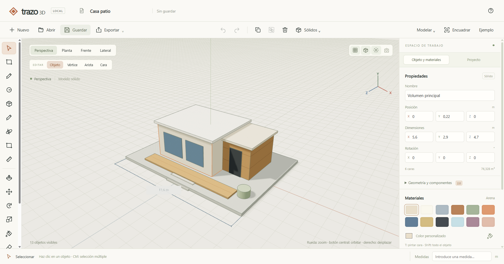

# Trazo 3D

Estoy desarrollando Trazo 3D para modelar en el escritorio, trabajar con medidas y guardar los proyectos en el equipo, sin depender de una conexión a Internet. La interfaz está en español y la distribución actual está preparada para Windows x64.



## Qué se puede hacer

- Dibujar rectángulos, círculos, polígonos, líneas y arcos.
- Extruir caras, crear contornos con Offset y llevar un perfil por un recorrido.
- Editar vértices, aristas y caras con manipuladores o medidas exactas.
- Unir, restar e intersectar sólidos.
- Trabajar con componentes vinculados, grupos anidados y etiquetas.
- Aplicar colores y texturas, guardar vistas y usar planos de sección.
- Añadir cotas asociadas a vértices y exportar láminas a escala en PDF o SVG.
- Guardar proyectos `.trazo` e intercambiar geometría OBJ, STL y un subconjunto de DXF.

Incluí un ejemplo de casa y una pequeña biblioteca local de muebles y elementos de construcción. La [guía de uso](docs/USO.md) explica las herramientas, los atajos y sus límites.

## Ejecutar la aplicación

El portable se abre con doble clic y no requiere instalar Node.js. El instalador permite elegir carpeta y crear un acceso directo. Ambos archivos se generan en `dist/`; no forman parte del código fuente del repositorio.

Si tienes una versión anterior abierta, guarda tu trabajo y ciérrala antes de abrir la nueva.

## Trabajar con el código

Necesitas Windows x64, Node.js 24 o superior y npm. Desde la carpeta del proyecto:

```powershell
npm ci
npm start
```

`npm start` compila el visor y abre Electron. Si tu versión de npm bloquea el script que descarga Electron, puedes prepararlo con:

```powershell
node node_modules/electron/install.js
```

Para ejecutar las pruebas y compilar el visor por separado:

```powershell
npm test
npm run build
```

Para comprobar la aplicación abierta y sus operaciones de archivos:

```powershell
npm run smoke
```

Estas comprobaciones usan un perfil independiente y dejan los resultados en `work/`.

## Compilar para Windows

```powershell
npm run dist
```

El resultado incluye un instalador y un portable en `dist/`. También dejé un flujo manual de GitHub Actions para generar esos archivos en Windows. La [guía de publicación](docs/PUBLICAR.md) explica cómo subir el repositorio y adjuntar los ejecutables a una versión.

## Cómo está organizado

| Carpeta o archivo                  | Contenido                                    |
| ---------------------------------- | -------------------------------------------- |
| `src/model.mjs`                    | Modelo de datos, validación e historial      |
| `src/modeling.mjs`                 | Operaciones geométricas, componentes y cotas |
| `src/app.mjs` y `src/studio.mjs`   | Herramientas y paneles de la interfaz        |
| `src/viewport*.mjs`                | Visor, cámaras, materiales y manipuladores   |
| `src/exchange.mjs`                 | DXF y láminas vectoriales                    |
| `src/main.cjs` y `src/preload.cjs` | Ventana y puente de archivos de Electron     |
| `tests/`                           | Pruebas geométricas y de persistencia        |
| `examples/`                        | Proyecto de ejemplo                          |
| `scripts/`                         | Comprobaciones y preparación de versiones    |

En [DESIGN.md](DESIGN.md) explico las decisiones de implementación.

## Lo que falta

Todavía no hay soporte para SKP, DWG, IFC, Revit o nubes de puntos, ni compatibilidad con plugins de SketchUp, Warehouse o V-Ray. La biblioteca es local y los recorridos son segmentados. Los planos exportados son proyecciones de aristas con cotas, sin eliminación completa de líneas ocultas.

Sigo ajustando los casos de geometría compleja. Conviene revisar los resultados de operaciones booleanas, contornos pequeños y contactos exactos antes de usarlos para fabricar o construir.

## Contribuir y licencia

Si encuentras un problema, abre un issue con los pasos para reproducirlo. Para enviar cambios, revisa [CONTRIBUTING.md](CONTRIBUTING.md).

El código del proyecto usa la [licencia MIT](LICENSE). Los avisos de las bibliotecas están en [THIRD-PARTY-NOTICES.txt](THIRD-PARTY-NOTICES.txt).
